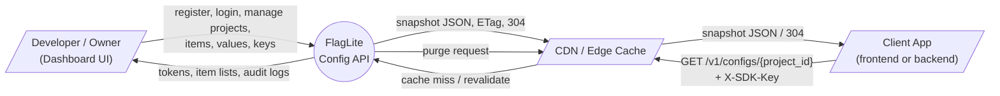
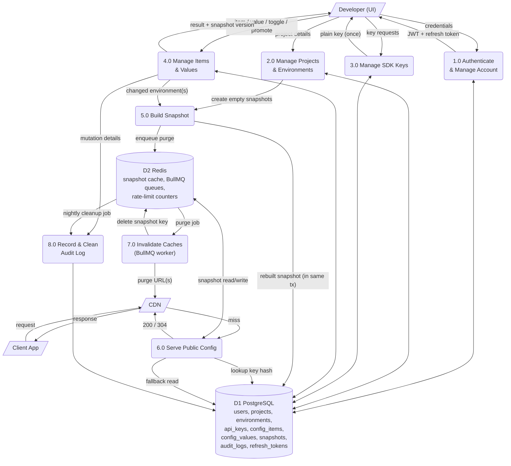
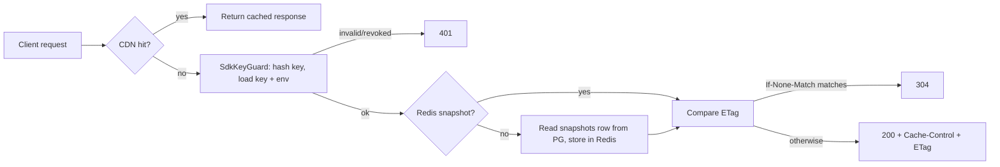

# 04 — Data Flow Diagram (DFD)

**Project:** Taped
**Notation:** Mermaid (renders on GitHub/GitLab). Rounded boxes = processes, cylinders = data stores, rectangles = external entities.

---

## 1. Level 0: Context Diagram



---

## 2. Level 1: Internal Processes



---

## 3. Process Descriptions

| Process                   | Input                                               | Processing                                                                                           | Output                                   |
| ------------------------- | --------------------------------------------------- | ---------------------------------------------------------------------------------------------------- | ---------------------------------------- |
| 1.0 Authenticate          | email, password, refresh token                      | Validate DTO, hash/verify (argon2id), issue/rotate tokens                                            | JWT, refresh token                       |
| 2.0 Manage Projects       | project name, ids                                   | Ownership check, create project + 2 environments                                                     | Project, environments                    |
| 3.0 Manage SDK Keys       | env, label, key id                                  | Generate random key, store SHA-256 + prefix, revoke                                                  | Plain key (once), key list               |
| 4.0 Manage Items & Values | item definitions, values, toggles, promote requests | Validate types/limits, write rows in a transaction                                                   | Updated item/value, new snapshot version |
| 5.0 Build Snapshot        | environment id                                      | Read all items + values for that env, produce `flags` and `configs` JSON, bump version, compute ETag | Snapshot row                             |
| 6.0 Serve Public Config   | `X-SDK-Key`, project id, `If-None-Match`            | Hash key → find env → compare project → read snapshot (Redis → Postgres) → 200 or 304                | Snapshot JSON + cache headers            |
| 7.0 Invalidate Caches     | purge job                                           | Delete Redis key, call CDN purge API, retry on failure                                               | Fresh cache state                        |
| 8.0 Audit                 | mutation events                                     | Insert audit row (same tx as the mutation); nightly delete > 90 days                                 | Audit entries                            |

---

## 4. Data Stores

| Store | Technology | Contents                                                              | Notes                                                |
| ----- | ---------- | --------------------------------------------------------------------- | ---------------------------------------------------- |
| D1    | PostgreSQL | All durable data                                                      | Source of truth                                      |
| D2    | Redis      | `snap:{environmentId}` (TTL 5 min), BullMQ queues, throttler counters | Losing Redis never loses data; reads fall back to D1 |
| D3    | CDN cache  | Public responses per `(URL, X-SDK-Key)`                               | Purged on write; bounded by `s-maxage`               |

---

## 5. Data Dictionary of Main Flows

| Flow            | Format         | Example / key fields                                                |
| --------------- | -------------- | ------------------------------------------------------------------- |
| Credentials     | JSON           | `{ email, password }`                                               |
| Value update    | JSON           | `{ value, rolloutPercentage?, expectedVersion? }`                   |
| Promote request | JSON           | `{ from: "staging", to: "production", keys?: ["new_checkout"] }`    |
| SDK key         | string         | `fl_pk_` + 32 random base62 chars                                   |
| Snapshot        | JSON           | `{ projectId, environment, version, updatedAt, flags, configs }`    |
| Purge job       | BullMQ payload | `{ projectId, environmentId, urls[] }`                              |
| Audit entry     | row            | `{ actor, action, entityType, entityId, before, after, createdAt }` |

---

## 6. Write Path (critical flow, simplified)

```mermaid
sequenceDiagram
    participant UI as Dashboard
    participant API as NestJS API
    participant PG as PostgreSQL
    participant R as Redis / BullMQ
    participant CDN as CDN

    UI->>API: POST .../toggle (JWT)
    API->>PG: BEGIN
    API->>PG: UPDATE config_values (flip, version+1)
    API->>PG: Rebuild snapshot row (version+1, etag)
    API->>PG: INSERT audit_logs
    API->>PG: COMMIT
    API->>R: DEL snap:{env}; add job cache-purge
    API-->>UI: 200 { value, snapshotVersion }
    R->>CDN: Purge /v1/configs/{project_id}
```

## 7. Read Path (critical flow, simplified)


