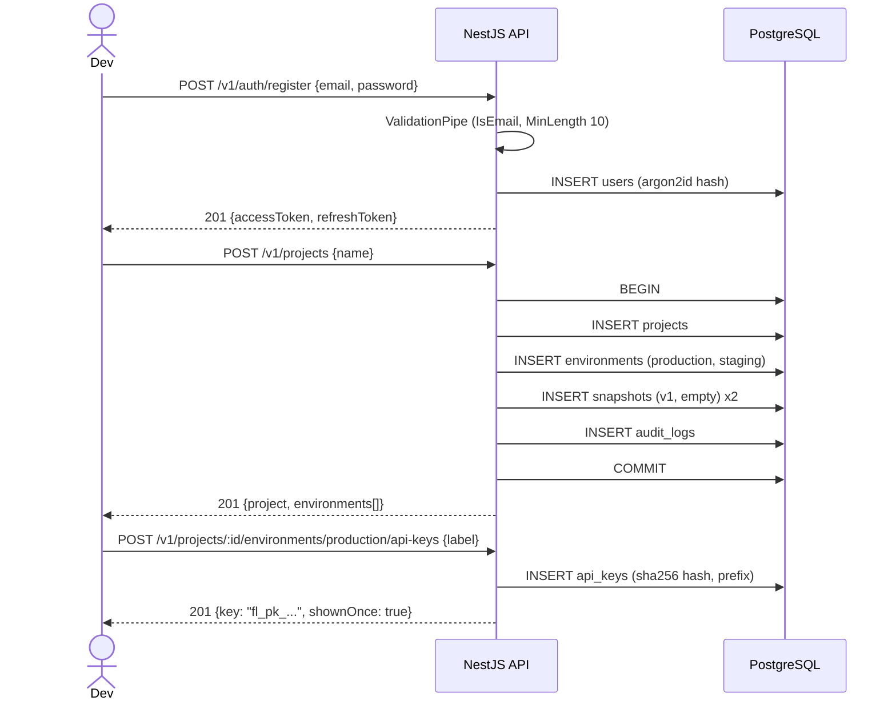
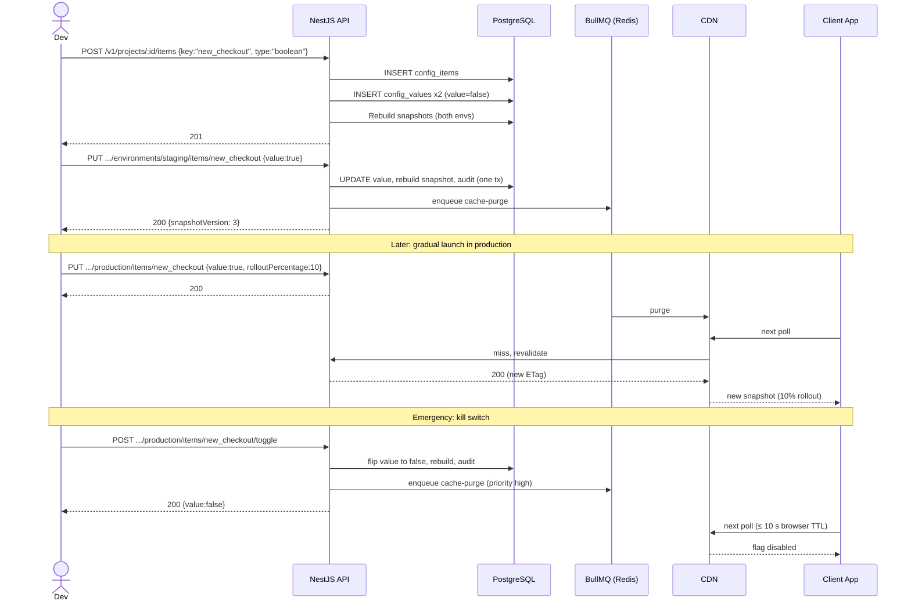
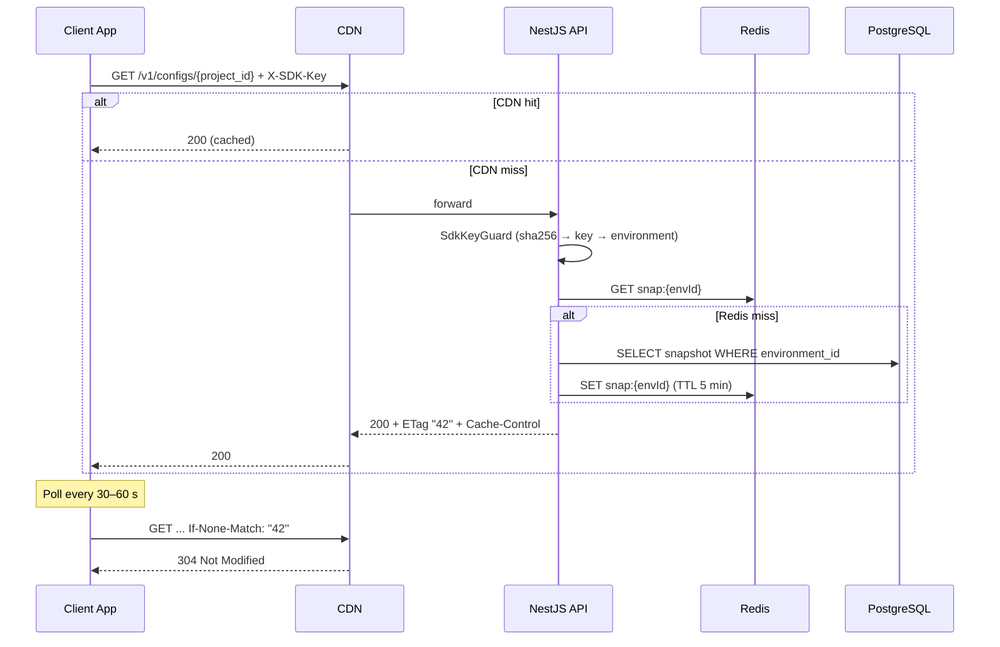
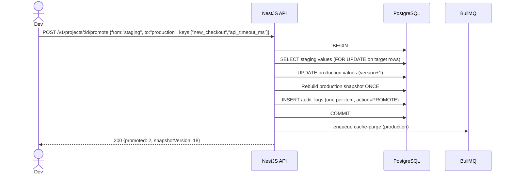

# 05 — User Journey Technical Flow (UJTF)

**Project:** Taped
**Purpose:** Walk each user journey step by step and show which API calls, validations, and database/queue actions happen. Each journey doubles as an e2e test scenario (see doc 07).

**Personas**

| Persona         | Description                                                      |
| --------------- | ---------------------------------------------------------------- |
| **Dev (Owner)** | Solo developer using the dashboard.                              |
| **Client App**  | The developer's frontend/backend reading config with an SDK key. |

---

## J1: Onboarding (register → project → SDK key)

**Goal:** In under 2 minutes the Dev has an SDK key to paste into their app.



| Step           | Failure case               | Response               |
| -------------- | -------------------------- | ---------------------- |
| Register       | Email already used         | `409 Conflict`         |
| Register       | Weak password              | `400` with `details[]` |
| Create project | Missing/invalid JWT        | `401`                  |
| Create key     | Environment not in project | `404`                  |

---

## J2: Create a flag and toggle it (including the **kill switch** case)

**Goal:** Launch a feature without redeploy, or kill a broken one fast.



**Propagation timeline (production toggle)**

| Time     | Event                                              |
| -------- | -------------------------------------------------- |
| T+0      | DB commit, API responds.                           |
| T+≈0.1 s | Redis key deleted.                                 |
| T+≈1–3 s | CDN purge completes.                               |
| T+≤10 s  | Browsers/apps that honour `max-age=10` revalidate. |
| T+≤60 s  | Worst case if purge failed (`s-maxage`).           |

| Step        | Failure case                         | Response                                       |
| ----------- | ------------------------------------ | ---------------------------------------------- |
| Create item | Duplicate key                        | `409`                                          |
| Create item | 201st item                           | `422` (limit)                                  |
| Set value   | Wrong type (`"yes"` for boolean)     | `400`                                          |
| Set value   | `rolloutPercentage` on a string item | `400`                                          |
| Set value   | Stale `expectedVersion`              | `409`                                          |
| Toggle      | Item not boolean                     | `400`                                          |
| Purge job   | CDN API error                        | Retry 5× with backoff; write already succeeded |

---

## J3: Client app fetches and polls config

**Goal:** Fast, cheap reads with minimal bandwidth.



**Client-side flag evaluation**

```ts
// pseudo-code for the optional SDK helper
function isEnabled(snapshot, flagKey, userId) {
  const f = snapshot.flags[flagKey];
  if (!f || !f.enabled) return false;
  if (f.rollout >= 100) return true;
  return murmur3_32(`${flagKey}:${userId}`) % 100 < f.rollout;
}
```

| Case                                 | Response                                                    |
| ------------------------------------ | ----------------------------------------------------------- |
| Missing `X-SDK-Key`                  | `401`                                                       |
| Revoked key                          | `401` (after cache TTL / purge)                             |
| Key belongs to another project       | `404` (not `403`, to avoid leaking project existence)       |
| `?env=staging` with a production key | `403`                                                       |
| Origin down                          | CDN serves stale for up to 300 s (`stale-while-revalidate`) |
| Throttled                            | `429` + `Retry-After`                                       |

---

## J4: Promote staging → production

**Goal:** Test in staging, then copy the verified values to production in one action.



| Case                        | Response                |
| --------------------------- | ----------------------- |
| `from === to`               | `400`                   |
| A listed key does not exist | `404` (nothing applied) |
| Omitted `keys`              | All items promoted      |

---

## J5: Rotate / revoke an SDK key

**Goal:** Replace a leaked or old key without downtime.

1. Dev creates a **new** key for the environment (`POST .../api-keys`).
2. Dev updates the app to use the new key and deploys.
3. Dev revokes the old key (`DELETE .../api-keys/:keyId`): sets `revoked_at`, enqueues a CDN purge.
4. Requests using the old key return `401` once the cache expires/purges.

Both keys are valid at the same time during step 2, which is what makes the rotation zero-downtime.

---

## J6: Review the audit log (support journey)

1. Dev opens "Activity" in the UI → `GET /v1/projects/:id/audit-logs?environment=production&limit=50`.
2. API returns entries newest-first with `before` / `after` JSON and the actor's email.
3. Dev spots the unintended toggle and fixes it via J2.

---

## Cross-journey technical rules

- Every management endpoint: `JwtAuthGuard` → `ProjectOwnerGuard` (404 if not owner) → `ValidationPipe`.
- Every mutation: one DB transaction containing the change, the snapshot rebuild, and the audit row. Queue jobs are enqueued **after** commit.
- Public endpoint: `SdkKeyGuard` only; no JWT, no cookies.
