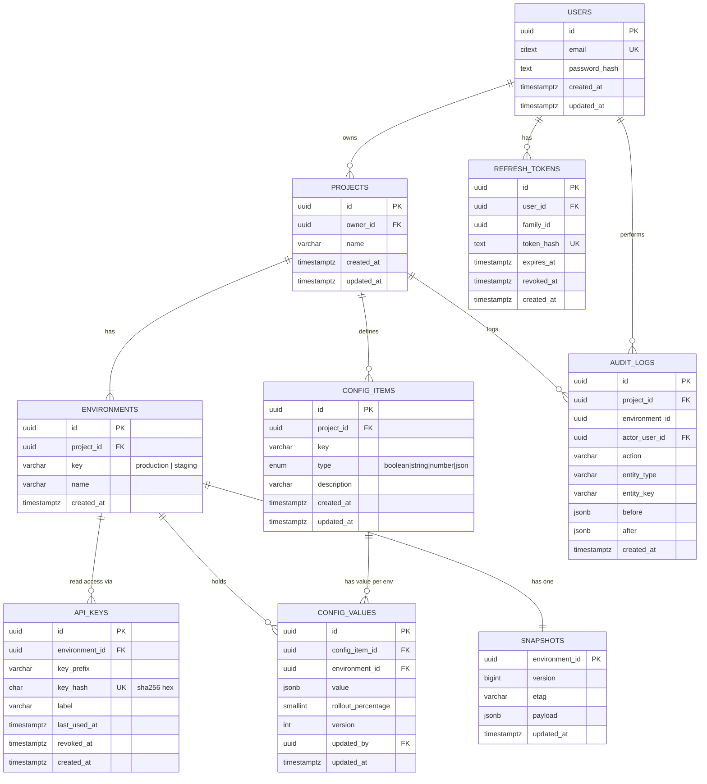

# 06 — Database Schema Planning (DSP)

**Project:** Taped
**Database:** PostgreSQL 15+ via TypeORM (migrations only, `synchronize: false`)
**Conventions:** `snake_case` columns, `uuid` primary keys (`gen_random_uuid()`), `timestamptz` timestamps in UTC, `created_at` / `updated_at` on every mutable table.

---

## 1. Entity Relationship Diagram



---

## 2. Table Definitions

### 2.1 `users`

| Column                  | Type        | Constraints               |
| ----------------------- | ----------- | ------------------------- |
| id                      | uuid        | PK                        |
| email                   | citext      | NOT NULL, UNIQUE          |
| password_hash           | text        | NOT NULL                  |
| created_at / updated_at | timestamptz | NOT NULL, default `now()` |

> Requires `CREATE EXTENSION IF NOT EXISTS citext;` (first migration).

### 2.2 `refresh_tokens`

| Column     | Type        | Constraints                      |
| ---------- | ----------- | -------------------------------- |
| id         | uuid        | PK                               |
| user_id    | uuid        | FK → users, ON DELETE CASCADE    |
| family_id  | uuid        | NOT NULL (token-rotation family) |
| token_hash | text        | NOT NULL, UNIQUE                 |
| expires_at | timestamptz | NOT NULL                         |
| revoked_at | timestamptz | NULL                             |
| created_at | timestamptz | NOT NULL                         |

Indexes: `(user_id)`, `(family_id)`.

### 2.3 `projects`

| Column                  | Type        | Constraints                   |
| ----------------------- | ----------- | ----------------------------- |
| id                      | uuid        | PK (public `project_id`)      |
| owner_id                | uuid        | FK → users, ON DELETE CASCADE |
| name                    | varchar(60) | NOT NULL                      |
| created_at / updated_at | timestamptz |                               |

Indexes: `(owner_id)`.

### 2.4 `environments`

| Column     | Type        | Constraints                      |
| ---------- | ----------- | -------------------------------- |
| id         | uuid        | PK                               |
| project_id | uuid        | FK → projects, ON DELETE CASCADE |
| key        | varchar(32) | NOT NULL                         |
| name       | varchar(60) | NOT NULL                         |
| created_at | timestamptz |                                  |

Constraints: `UNIQUE (project_id, key)`, `CHECK (key ~ '^[a-z0-9_-]+$')`. The MVP inserts `production` and `staging`.

### 2.5 `api_keys`

| Column         | Type        | Constraints                          |
| -------------- | ----------- | ------------------------------------ |
| id             | uuid        | PK                                   |
| environment_id | uuid        | FK → environments, ON DELETE CASCADE |
| key_prefix     | varchar(12) | NOT NULL (e.g. `fl_pk_Ab3d`)         |
| key_hash       | char(64)    | NOT NULL, UNIQUE                     |
| label          | varchar(60) | NULL                                 |
| last_used_at   | timestamptz | NULL                                 |
| revoked_at     | timestamptz | NULL                                 |
| created_at     | timestamptz |                                      |

Indexes: `UNIQUE (key_hash)` (hot path for every public request), `(environment_id)`.

### 2.6 `config_items`

| Column                  | Type                    | Constraints                      |
| ----------------------- | ----------------------- | -------------------------------- |
| id                      | uuid                    | PK                               |
| project_id              | uuid                    | FK → projects, ON DELETE CASCADE |
| key                     | varchar(64)             | NOT NULL                         |
| type                    | `config_item_type` enum | NOT NULL                         |
| description             | varchar(280)            | NULL                             |
| created_at / updated_at | timestamptz             |                                  |

Constraints: `UNIQUE (project_id, key)`, `CHECK (key ~ '^[a-z0-9][a-z0-9_.-]{0,63}$')`.
Enum: `CREATE TYPE config_item_type AS ENUM ('boolean','string','number','json');`
Limit of 200 items per project is enforced in the service (count in the same tx, with a row lock on the project).

### 2.7 `config_values`

| Column             | Type        | Constraints                                                           |
| ------------------ | ----------- | --------------------------------------------------------------------- |
| id                 | uuid        | PK                                                                    |
| config_item_id     | uuid        | FK → config_items, ON DELETE CASCADE                                  |
| environment_id     | uuid        | FK → environments, ON DELETE CASCADE                                  |
| value              | jsonb       | NOT NULL                                                              |
| rollout_percentage | smallint    | NOT NULL, default 100, `CHECK (rollout_percentage BETWEEN 0 AND 100)` |
| version            | int         | NOT NULL, default 1 (optimistic concurrency)                          |
| updated_by         | uuid        | FK → users, ON DELETE SET NULL                                        |
| updated_at         | timestamptz |                                                                       |

Constraints: `UNIQUE (config_item_id, environment_id)`.
Indexes: `(environment_id)` for snapshot builds.
Type correctness (boolean value for boolean items, etc.) is validated in the service layer; `rollout_percentage` is only meaningful for boolean items and stays 100 otherwise.

### 2.8 `snapshots`

| Column         | Type        | Constraints                              |
| -------------- | ----------- | ---------------------------------------- |
| environment_id | uuid        | PK, FK → environments, ON DELETE CASCADE |
| version        | bigint      | NOT NULL, increments on every rebuild    |
| etag           | varchar(64) | NOT NULL                                 |
| payload        | jsonb       | NOT NULL                                 |
| updated_at     | timestamptz |                                          |

One row per environment; the public endpoint reads exactly this row.

### 2.9 `audit_logs`

| Column         | Type        | Constraints                                                                                        |
| -------------- | ----------- | -------------------------------------------------------------------------------------------------- |
| id             | uuid        | PK                                                                                                 |
| project_id     | uuid        | NOT NULL (no FK, so history survives project delete until the cleanup job removes it; see note)    |
| environment_id | uuid        | NULL                                                                                               |
| actor_user_id  | uuid        | FK → users, ON DELETE SET NULL                                                                     |
| action         | varchar(32) | e.g. `ITEM_CREATE`, `VALUE_SET`, `TOGGLE`, `PROMOTE`, `KEY_CREATE`, `KEY_REVOKE`, `PROJECT_DELETE` |
| entity_type    | varchar(32) | `item`, `value`, `api_key`, `project`                                                              |
| entity_key     | varchar(64) | item key or key prefix                                                                             |
| before / after | jsonb       | NULL                                                                                               |
| created_at     | timestamptz | NOT NULL                                                                                           |

Indexes: `(project_id, created_at DESC)`, `(created_at)` for retention cleanup.

> Decision to confirm: keep audit rows after a project is deleted (current plan, until the 90-day cleanup) or delete them with the project.

---

## 3. Snapshot Payload Contract

Stored in `snapshots.payload` and returned verbatim by the public endpoint:

```json
{
  "projectId": "3f1c2c9e-7a3b-4f2f-9d55-0c1a8d6e1b11",
  "environment": "production",
  "version": 42,
  "updatedAt": "2026-10-21T10:15:00.000Z",
  "flags": { "new_checkout": { "enabled": true, "rollout": 25 } },
  "configs": { "api_timeout_ms": 3000, "theme": { "primary": "#00aaff" } }
}
```

Build query (per environment):

```sql
SELECT i.key, i.type, v.value, v.rollout_percentage
FROM config_values v
JOIN config_items i ON i.id = v.config_item_id
WHERE v.environment_id = $1
ORDER BY i.key;
```

`etag = sha1(version || ':' || environment_id)` (weak hashing is fine; it is a cache validator, not a secret).

---

## 4. Key Queries & Index Coverage

| Use case               | Query                                                                            | Index used                                     |
| ---------------------- | -------------------------------------------------------------------------------- | ---------------------------------------------- |
| Authenticate SDK key   | `SELECT ... FROM api_keys WHERE key_hash = $1 AND revoked_at IS NULL`            | `UNIQUE (key_hash)`                            |
| Serve snapshot         | `SELECT * FROM snapshots WHERE environment_id = $1`                              | PK                                             |
| List items with values | items by project + join values by env ids                                        | `UNIQUE (project_id, key)`, `(environment_id)` |
| Toggle                 | `UPDATE config_values SET ... WHERE config_item_id = $1 AND environment_id = $2` | `UNIQUE (config_item_id, environment_id)`      |
| Audit page             | `WHERE project_id = $1 ORDER BY created_at DESC LIMIT 50`                        | `(project_id, created_at DESC)`                |

---

## 5. TypeORM Notes

```ts
@Entity('config_values')
@Unique(['configItemId', 'environmentId'])
export class ConfigValue {
  @PrimaryGeneratedColumn('uuid') id: string;

  @Column({ name: 'config_item_id' }) configItemId: string;
  @ManyToOne(() => ConfigItem, (i) => i.values, { onDelete: 'CASCADE' })
  @JoinColumn({ name: 'config_item_id' })
  item: ConfigItem;

  @Column({ name: 'environment_id' }) environmentId: string;
  @ManyToOne(() => Environment, { onDelete: 'CASCADE' })
  @JoinColumn({ name: 'environment_id' })
  environment: Environment;

  @Column({ type: 'jsonb' }) value: unknown;

  @Column({ name: 'rollout_percentage', type: 'smallint', default: 100 })
  rolloutPercentage: number;

  @VersionColumn() version: number; // optimistic locking

  @UpdateDateColumn({ name: 'updated_at', type: 'timestamptz' })
  updatedAt: Date;
}
```

- Use a `SnakeNamingStrategy` or explicit column names consistently.
- Wrap mutation + snapshot rebuild + audit insert in `dataSource.transaction(...)`. Do **not** let queue calls happen inside the transaction.
- Use `pessimistic_write` locks on the `snapshots` row when rebuilding to serialize concurrent writers per environment.

---

## 6. Migrations Plan

| #   | Migration                   | Contents                                                     |
| --- | --------------------------- | ------------------------------------------------------------ |
| 001 | `init-extensions`           | `citext`, `pgcrypto` (if `gen_random_uuid()` is unavailable) |
| 002 | `users-and-tokens`          | `users`, `refresh_tokens`                                    |
| 003 | `projects-and-environments` | `projects`, `environments`                                   |
| 004 | `api-keys`                  | `api_keys`                                                   |
| 005 | `items-and-values`          | enum, `config_items`, `config_values`                        |
| 006 | `snapshots`                 | `snapshots`                                                  |
| 007 | `audit-logs`                | `audit_logs` + indexes                                       |

Rules: one concern per migration, always include `down()`, never edit a merged migration.

---

## 7. Sizing & Retention

| Item                                                  | Estimate                                                             |
| ----------------------------------------------------- | -------------------------------------------------------------------- |
| Snapshot size                                         | ~50 bytes/flag, ~100 bytes/config → typical 5–20 KB, hard cap 256 KB |
| Audit rows                                            | ~1 KB each; 90-day retention keeps it small                          |
| Row counts per 1,000 projects (200 items max, 2 envs) | up to ~400k `config_values` rows, trivial for Postgres               |
| Redis                                                 | one key per environment, a few MB total                              |

---

## 8. Future-proofing (not in MVP)

- `project_members (project_id, user_id, role)` for teams
- `config_value_history` for rollback
- `webhooks` table + delivery queue
- Custom environments are already supported by the schema (`environments.key` is free-form)
